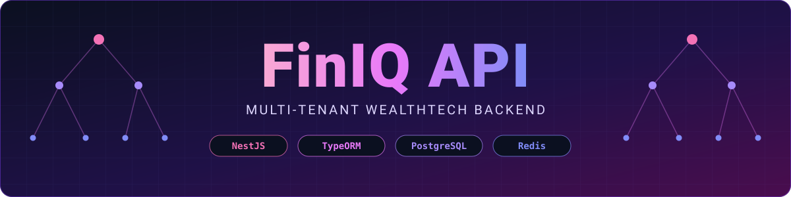
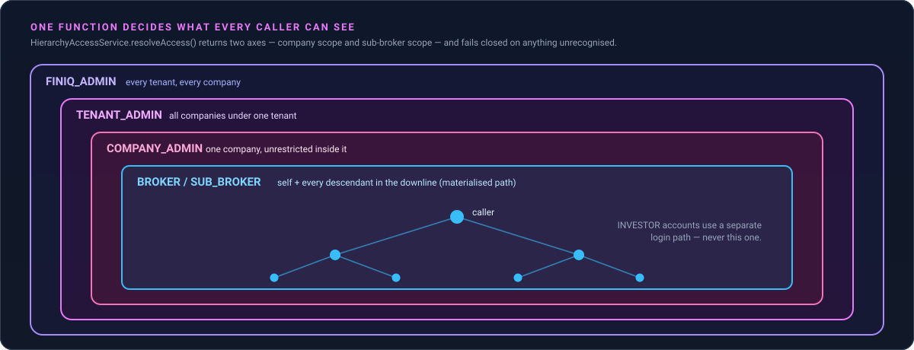
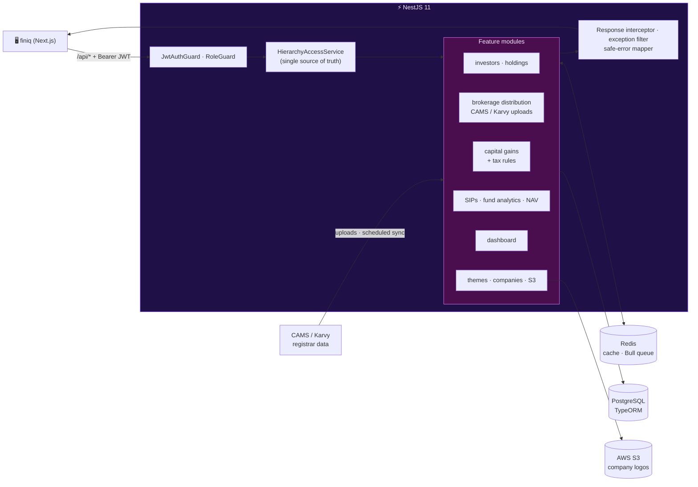
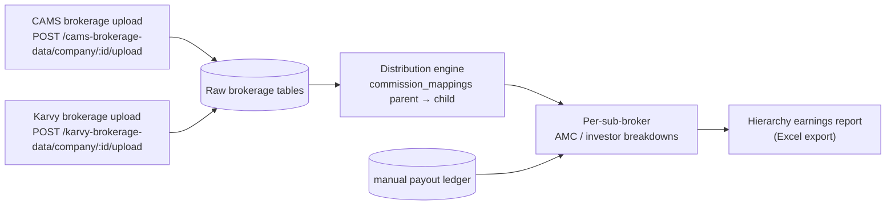
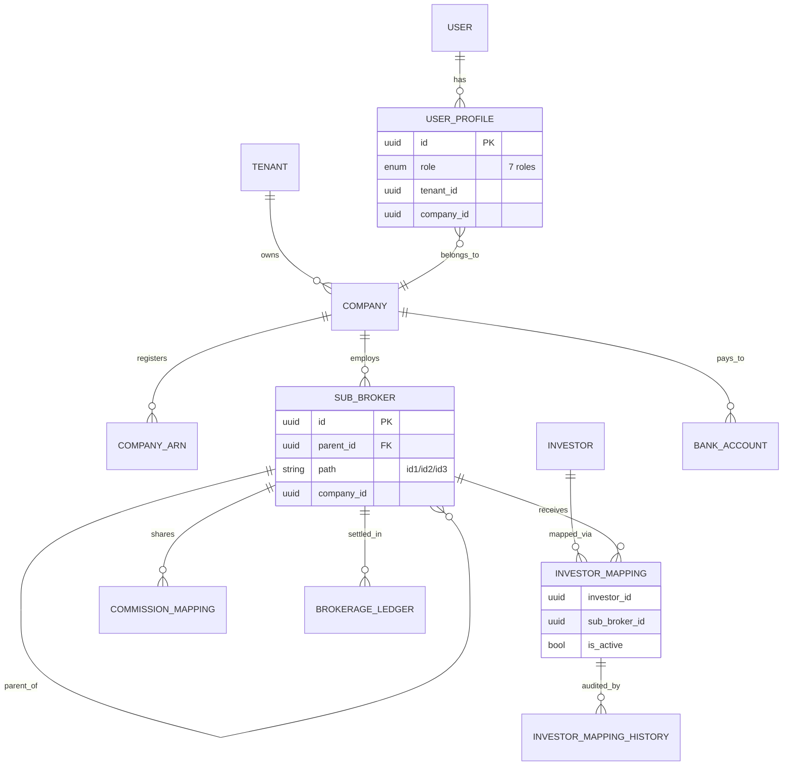

<div align="center">



<br/>

[](#-tech-stack)
[](#-tech-stack)
[](#-data-model)
[](#-data-model)
[](#-caching--background-work)
[](#-authentication)
[](#-tech-stack)
[](https://github.com/Sp2736/finiq)

**A multi-tenant wealth-management backend where one function decides what every caller may see — from platform admin down to a sub-broker's own downline — and every report is generated server-side from RTA data.**

</div>

---

## What is FinIQ API?

FinIQ API is the backend of **FinIQ**, a B2B2C WealthTech platform for **mutual fund distributors**. It ingests registrar (RTA) data from **CAMS** and **Karvy**, joins it with each distributor's broker hierarchy, and serves:

1. **Hierarchy-scoped data access** — tenants, companies, brokers and sub-brokers each see exactly their slice, enforced centrally.
2. **Investor holdings and portfolios** across both registrars, with Redis-backed caching and scheduled refresh.
3. **Brokerage distribution** — upload brokerage files, apply commission-sharing rules down the broker tree, and report earnings by sub-broker, AMC or investor, with a manual payout ledger.
4. **Capital gains** driven by a **rule table** (STCG/LTCG rates, exemptions, effective dates) rather than hardcoded tax logic.
5. **SIP / STP reporting**, fund analytics by AMFI code, NAV history, and a dashboard (AUM trend, portfolio distribution, performance).
6. **Server-generated exports** — PDF and Excel for holdings, transactions, capital gains and systematic reports.
7. **Per-company theming and logos** — theme records, S3-hosted logos with signed URLs.

It is the API half of a pair: the web app lives in [`finiq`](https://github.com/Sp2736/finiq).

<br/>

<div align="center">

<sub>Animated in a browser (GitHub renders raw SVG natively) — each scope lights up in turn, from the whole platform down to one downline.</sub>
</div>

---

## Table of Contents

- [Why This Exists](#why-this-exists)
- [Architecture at a Glance](#-architecture-at-a-glance)
- [Roles & Access Scopes](#-roles--access-scopes)
- [How Hierarchy Scoping Works](#-how-hierarchy-scoping-works)
- [Authentication](#-authentication)
- [Brokerage Distribution](#-brokerage-distribution)
- [Capital Gains & Tax Rules](#-capital-gains--tax-rules)
- [Caching & Background Work](#-caching--background-work)
- [Reports & Exports](#-reports--exports)
- [Response Format & Error Handling](#-response-format--error-handling)
- [Data Model](#-data-model)
- [API Surface](#-api-surface)
- [Tech Stack](#-tech-stack)
- [Getting Started](#-getting-started)
- [Configuration Reference](#-configuration-reference)
- [Project Layout](#-project-layout)
- [Hardening Roadmap](#-hardening-roadmap)

---

## Why This Exists

A distributor's data is shaped like a tree — company → brokers → sub-brokers → investors — and three problems fall out of that:

- **Visibility leaks easily.** If every module writes its own "what can this user see?" query, one of them will eventually be wrong. FinIQ API has **one** access resolver, and every module must use it.
- **RTA data is heavy and arrives in pieces.** CAMS and Karvy deliver different shapes; holdings, SIPs and brokerage have to be normalised, joined and cached before a dashboard can feel instant.
- **Money reports must be defensible.** Brokerage splits and capital gains need to be reproducible from stored rules and ledgers, not buried in controller code.

---

## 🏗 Architecture at a Glance



Cross-cutting behaviour (all registered globally in `main.ts`): an `AllExceptionsFilter`, a `LoggingInterceptor`, a `ResponseInterceptor` that wraps every reply in a consistent envelope and adds an `X-Response-Time` header, and CORS driven by environment.

---

## 👥 Roles & Access Scopes

Seven roles, resolved into two scope axes: **which companies** and **which sub-brokers**.

| Role | Company scope | Sub-broker scope | Typical use |
|---|---|---|---|
| `FINIQ_ADMIN` | **All** companies, all tenants | Unrestricted | Platform operator; onboards companies and ARNs |
| `TENANT_ADMIN` | Every company under their tenant | Unrestricted | Group-level owner of several companies |
| `COMPANY_ADMIN` | Exactly one company | Unrestricted within it | Distributor admin |
| `BROKER` | Their company only | **Self + all descendants** | A broker with a downline |
| `SUB_BROKER` | Their company only | **Self + all descendants** | A sub-broker (may have their own downline) |
| `COMPANY_USER` | Company staff role | Via role guards | Staff accounts |
| `INVESTOR` | Own data only | — | Separate login path; **explicitly rejected** by the broker-hierarchy resolver |

---

## 🧭 How Hierarchy Scoping Works

`HierarchyAccessService.resolveAccess(userPayload)` is *the one and only place* allowed to answer "what can this caller see or touch?". Every module calls it instead of writing its own version, and it **fails closed** on anything unrecognised.

It returns a context object:

```ts
{
  companyId,            // set for company-scoped callers, null for platform/tenant admins
  allowedCompanyIds,    // null = every company; otherwise the exact set
  tenantId,
  performedById,        // user_profiles.id — used in audit and history rows
  callerRole,
  callerSubBrokerId,
  allowedSubBrokerIds,  // null = unrestricted in scope; otherwise self + all descendants
}
```

Two helpers then enforce it: `assertCompanyAllowed()` for the tenant/company axis and `assertSubBrokerAllowed()` for the downline axis.

**Finding a downline fast:** sub-brokers are stored as a self-referencing tree with a **materialised path** (`id1/id2/id3`), so "everyone below me" is one indexed prefix query. Legacy rows without a path fall back to a breadth-first walk, with a warning logged so the data can be repaired.

A broker whose JWT predates the `sub_broker_id` claim is **refused and asked to log in again** rather than silently granted a wider view.

---

## 🔐 Authentication

| Flow | Endpoints | Notes |
|---|---|---|
| **Staff (OTP)** | `POST /api/auth/send-otp` → `verify-otp` | Numeric OTP from a cryptographically secure RNG; configurable length and expiry; one-time use |
| **Token refresh** | `POST /api/auth/refresh` | Refresh tokens are stored **hashed** and compared against the hash |
| **Session** | `GET /api/auth/me` · `POST /api/auth/logout` | |
| **Investor** | `/api/investor-auth/*` | Login, logout and a full forgot-password flow (send OTP → verify → reset) — a separate token type from staff |
| **Credential provisioning** | `POST /api/investors/:id/credentials` | Staff can generate investor credentials; sub-brokers get **automatic login provisioning** |

JWTs carry the caller's role profiles (and company, tenant and sub-broker identifiers), which is what the hierarchy resolver reads. A company logo is embedded at login so the frontend can brand the session immediately.

---

## 💸 Brokerage Distribution

The money path. Registrar brokerage files are uploaded per company and distributed down the broker tree according to **commission mappings**.



- **Parent-to-child sharing** is read from `commission_mappings` (broker → sub-broker), so a sub-broker's cut and their parent's remainder are explicit data.
- **Detailed distribution** reports are grouped by sub-broker and either **AMC** or **investor**, with window functions producing report totals in a single query.
- **Manual payout ledger** — `POST /brokerage-distribution/ledger-entries` records payments actually made, so *gross receivable*, *paid*, and *net receivable* reconcile per broker.
- **Date-range correctness** — hierarchy earnings use **range-overlap** logic rather than strict containment, so brokerage that straddles a reporting window is attributed instead of dropped.
- **Bank accounts** — `POST /api/admin/bank-accounts` stores payout accounts per company, ARN or sub-broker.

---

## 🧾 Capital Gains & Tax Rules

Tax treatment is **data, not code**. The `capital_gains_tax_rules` table holds:

| Field | Meaning |
|---|---|
| `asset_class` | e.g. `EQUITY`, `DEBT` |
| `tax_type` | `STCG` or `LTCG` |
| `rate_percentage` | Applicable rate |
| `effective_from` / `effective_till` | Validity window, so rule changes don't rewrite history |
| `exemption_limit` | e.g. the equity LTCG exemption |
| `indexation_benefit` | Whether indexation applies |

`TaxCalculatorService` classifies each redemption as short- or long-term, selects the rule in force on the relevant date, applies the exemption, and the capital-gains module produces both the statement and its export. Rules are managed through a CRUD endpoint, so a Budget change is a data update, not a deploy. XIRR is available through a shared `FinancialUtils`.

---

## ⚡ Caching & Background Work

| Mechanism | What it does |
|---|---|
| **Holdings cache** | Per-investor holdings for **both registrars** are computed in batches (`Promise.allSettled`, so one provider failing doesn't sink the other) and stored in Redis under `holdings:cams:*` / `holdings:karvy:*`. Failed batches are retried |
| **Scheduled refresh** | A cron job refreshes all holdings **every 3 hours**; `POST /api/holdings-cache/refresh` triggers it on demand |
| **Company summaries** | Cached rollups power `company-summary` and `top-contributors` so dashboards don't scan transactions on every load |
| **Bull queue** | A `scraping` queue runs headless-browser jobs for automated report retrieval, with job-status polling and retries |
| **NAV history** | Range sync endpoint populates fund NAVs used by analytics |

---

## 📤 Reports & Exports

| Report | Where it's generated |
|---|---|
| Holdings (Excel / PDF) | `investors-export.service` |
| Transaction report | `transactions-export.service` |
| Capital gains statement | `capital-gains-export.service` |
| Systematic (SIP/STP) report | `systematic-report-export.service` |
| Hierarchy earnings (by AMC or by Investor) | brokerage distribution reports |

Generating files **on the server** — rather than shipping large payloads to the browser to be reshaped into documents — removes redundant data round-trips and keeps the formatting logic in one place.

---

## 🛡 Response Format & Error Handling

Every response uses one envelope (`success`, `message`, `data`, …) produced by the response interceptor, with an `X-Response-Time` header for monitoring.

Errors are **sanitised on purpose**. A `safe-error` helper maps known PostgreSQL error codes to user-safe messages and never forwards the raw driver message, so table, column and constraint names don't reach clients. Full detail is logged server-side:

| Postgres code | User sees |
|---|---|
| `23505` | "This record already exists." |
| `23503` | "…related data is linked elsewhere." |
| `23502` | "A required field is missing." |
| `22P02` | "…an invalid format." |
| `23514` | "…does not meet a required condition." |

---

## 🗄 Data Model

29 TypeORM entities. The core shape:



- **Registrar data** — separate CAMS and Karvy entities for investor master data, transactions, scheme details, SIP/STP registrations and brokerage; plus NAV history.
- **Rules & money** — capital-gains tax rules, commission mappings, brokerage ledger.
- **Integrity** — `investor_mappings` is unique on `(investor_id, sub_broker_id)`, and every assign/unassign writes to a history table with the acting user.
- **Schema management** — TypeORM `synchronize` is **off**; schema changes are applied deliberately.

---

## 🔌 API Surface

| Area | Base route | Highlights |
|---|---|---|
| **Auth** | `/api/auth` | `send-otp` · `verify-otp` · `refresh` · `logout` · `me` |
| **Investor auth** | `/api/investor-auth` | `login` · `send-otp` · `forgot-password/*` |
| **Companies** | `/api/companies` | create company / user / ARN · logo upload, delete, signed URL |
| **User management** | `/api/admin/users` | CRUD · `hierarchy` · `all-users` |
| **Investors** | `/api/investors` | search · by folio / PAN · holdings · balance · folio status · capital gains · exports · credentials |
| **Investor mapping** | `/api/companies/investor-mapping` | `brokers` · `investors` · `history` · `assign` · `unassign` |
| **Brokerage** | `/api/brokerage-distribution` | hierarchy · sub-brokers · AMC breakdown · detailed summary · ledger entries |
| **Brokerage uploads** | `/api/cams-brokerage-data` · `/api/karvy-brokerage-data` | per-company file upload |
| **RTA data** | `/api/cams-*` · `/api/karvy-scheme-details` | investor static details, transactions, scheme and SIP/STP details |
| **Holdings cache** | `/api/holdings-cache` | `refresh` · `company-summary` · `top-contributors` · `investors` |
| **Capital gains** | `/api/capital-gains` · `/capital-gains-tax-rules` | statement + export · tax rule CRUD |
| **SIPs** | `/api/sips` | company summary · investor SIPs · detail · systematic report + export |
| **Fund analytics** | `/api/fund-analytics` | returns · monthly returns · composition · style box · risk stats · sectors · holdings (by AMFI code) |
| **NAV** | `/api/nav-history` | list · `sync-range` |
| **Dashboard** | `/api/dashboard` | `summary` · `aum-trend` · `portfolio-distribution` · `performance` |
| **Broker transactions** | `/api/admin/broker-transactions` | `summary` · per-sub-broker history |
| **Bank accounts** | `/api/admin/bank-accounts` | list · create |
| **Themes** | `/api/themes` | `active` · `saved` CRUD · `activate` · `activate-default` |
| **Scraping** | `/scraping` | queued login jobs with job-status lookup |

---

## 🛠 Tech Stack

| Layer | Technology |
|---|---|
| **Framework** | NestJS 11 · TypeScript · RxJS |
| **Data** | PostgreSQL · TypeORM 0.3 · `pg` |
| **Cache & queues** | Redis · `cache-manager` (Redis store) · Bull · `@nestjs/schedule` |
| **Auth** | Passport JWT · `@nestjs/jwt` · bcryptjs · OTP |
| **Validation** | class-validator · class-transformer |
| **Documents** | ExcelJS · jsPDF + AutoTable · `xlsx` |
| **Files & images** | AWS SDK v3 (S3 + presigned URLs) · sharp |
| **Automation** | Playwright · Tesseract.js (queue-driven worker) |
| **Tooling** | Jest · Supertest · ESLint 9 · Prettier · SWC |

---

## 🚀 Getting Started

**Prerequisites:** Node.js 20+, PostgreSQL, and Redis on the default local port.

```bash
git clone https://github.com/Sp2736/finiq-api.git
cd finiq-api

npm install
cp .env.example .env          # fill in the values below

npm run start:dev             # watch mode — http://localhost:3000
```

```bash
npm run build         # compile
npm run start:prod    # run compiled output
npm run test          # unit tests
npm run test:e2e      # e2e tests
npm run lint
```

Pair it with the web app: run [`finiq`](https://github.com/Sp2736/finiq) on port 3001 — its `/api/*` calls rewrite to this service.

---

## 🔧 Configuration Reference

| Variable | Purpose |
|---|---|
| `DB_HOST` · `DB_PORT` · `DB_USERNAME` · `DB_PASSWORD` · `DB_DATABASE` | PostgreSQL connection |
| `DB_LOGGING` | Toggle TypeORM query logging |
| `JWT_SECRET` | Signing secret for access tokens (**required**) |
| `JWT_ACCESS_TOKEN_EXPIRATION` | Access-token lifetime |
| `JWT_REFRESH_TOKEN_EXPIRATION_DAYS` | Refresh-token lifetime in days |
| `OTP_LENGTH` · `OTP_EXPIRATION_MINUTES` | OTP shape and validity (defaults: 4 digits, 5 minutes) |
| `CORS_ORIGIN` | Comma-separated allowed origins (default `http://localhost:3001`) |
| `PORT` | HTTP port (default `3000`) |
| `REDIS_URL` | Redis URL used by the holdings cache |
| `AWS_REGION` · `AWS_S3_BUCKET_NAME` | S3 bucket for company logos |
| `NODE_ENV` | Environment name |

---

## 📁 Project Layout

```
finiq-api/
├── src/
│   ├── main.ts                      # bootstrap: filters, interceptors, CORS
│   ├── app.module.ts                # module wiring, Redis cache, Bull
│   ├── common/
│   │   ├── services/                # hierarchy-access · cache · transaction · health
│   │   ├── guards/ decorators/      # JwtAuthGuard · RoleGuard · @Roles
│   │   ├── interceptors/ filters/   # response envelope · logging · exceptions
│   │   ├── utils/                   # safe-error · financial (XIRR) · pagination · query builder
│   │   └── base/                    # base service / repository
│   ├── entities/                    # 29 TypeORM entities
│   ├── config/ database/            # TypeORM configuration
│   └── modules/
│       ├── auth · investor-auth · user-management · companies
│       ├── investors · investor-mapping · investor-apis (fund analytics)
│       ├── cams-* · karvy-*         # registrar data + brokerage uploads
│       ├── brokerage-distribution · broker-transactions · bank-accounts
│       ├── capital-gains · capital-gains-tax-rule · tax-calculation
│       ├── holdings-cache · dashboard · sips · nav-history
│       ├── themes · s3 · scraping
├── test/                            # e2e scaffolding
└── *.md                             # design notes: hierarchy earnings, theme tasks, export refactor
```

---

## 🗺 Hardening Roadmap

What's solid: central hierarchy scoping, sanitised errors, hashed refresh tokens, rule-driven tax, cached holdings. What's queued before a production hardening pass:

- [ ] Put `JwtAuthGuard` / role guards on the **tax-rule CRUD** and **scraping** controllers
- [ ] Remove the development fallback for `JWT_SECRET` so the app refuses to boot without it
- [ ] Remove the debug SIP-data endpoint from the investors controller
- [ ] Read the Redis host/port for the cache module and Bull from environment (currently local defaults)
- [ ] Replace the console-logged OTP with an SMS/WhatsApp provider, and add rate limiting on OTP endpoints
- [ ] Move the startup auto-migration of the themes table into proper migrations
- [ ] Add unit tests for the hierarchy resolver, tax calculator and brokerage distribution — the highest-risk logic
- [ ] Add an API reference (OpenAPI) generated from the controllers

---

## 🔗 Related Repository

| Repo | Role |
|---|---|
| [`finiq`](https://github.com/Sp2736/finiq) | Next.js frontend — distributor, investor and admin portals, per-company theming, calculators |

<div align="center">
<sub>One resolver for access. One envelope for responses. Rules in data, not in code.</sub>
</div>
